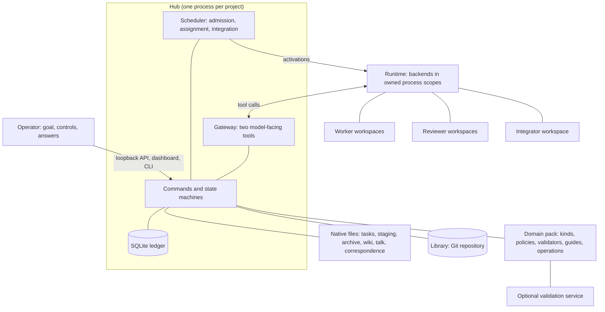

# Geyser design

Status: implemented in Geyser 0.1.0, 2026-11-06. This file is the authoritative
description of behavior. A change in behavior updates this file and `CHANGELOG.md`.
PLAN.md lists what is not yet implemented.

Reading guide: sections 1 to 4 give the purpose, the fixed rules and the
architecture. Sections 5 to 16 specify behavior, section 17 is the extension
boundary, and section 19 lists the invariants tests check. [PLAN.md](PLAN.md) holds
the milestones, the port of FormalGeyser, the open questions and the measurements
from FormalGeyser's runs behind many defaults.

## 1. Purpose and scope

Geyser is a framework in which LLM agents self-organize and divide a large task
among themselves.

- Any agent can publish a self-contained subtask with clear acceptance conditions.
- Each open subtask goes to a suitable idle agent or to a new one.
- All agents share a product Library, a Wiki of lessons learned, and direct
  messaging.
- Coordination follows fixed rules. There is no centralized orchestrator.

Geyser is one Python 3.13 distribution. It contains a local persistent
coordination service (the Hub), adapters that run agents on native agent runtimes
(Codex and Claude Code), a gateway through which agents call the Hub, and an
extension boundary for domain packs. It contains no workload and no reasoning
phases.

### 1.1 Relationship to FormalGeyser

FormalGeyser (`../Task-based-auto-formalize`) is Geyser adapted to formalizing
mathematics in Lean, with a stricter workflow. Definitions, theorem statements and
proofs are separate units. Each unit is a Lean file paired with a Markdown
explanation. Each pair passes Lean verification and an independent semantic review
before an Integrator merges it into the shared Library.

FormalGeyser today bundles its own coordinator (`formal_geyser.coordination`,
called TaskHub). That coordinator was built for Lean and generalized in place, so
general rules and Lean rules are interleaved in one package. Geyser extracts the
general mechanisms into a package of their own, designed from the start around an
explicit extension boundary. The target is that FormalGeyser becomes Geyser plus a
Lean domain pack and a strict project configuration, with no coordination code of
its own (PLAN.md, section 3).

Geyser keeps TaskHub's rules and the evidence behind them. It does not copy
TaskHub's code, its compatibility layers, or the history of its formats.

### 1.2 What is general and what is strict

| Concern | Geyser (general) | FormalGeyser (strict profile) |
| --- | --- | --- |
| Unit of contribution | A pack-defined contribution kind; the general pack accepts any files | Definition, statement, proof as separate kinds |
| File rules | Per kind | Every Lean file has same-stem Markdown |
| Machine validation | Optional per policy | Mandatory Lake build, kernel replay, target checks |
| Independent review | Always required before publication | Required, with three-way literature correspondence |
| Integration | `direct` (mechanical merge) or `batch` (Integrator agent) | `batch` only |

The invariant both share is that nothing reaches the Library without an
independent review of its exact bytes.

### 1.3 Non-goals

- No model supervises reasoning or reads every conversation. Two narrow,
  tool-less decisions exist (section 6), and they answer only a schema.
- No fixed roles or phases of reasoning. Planning is a task like any other.
- No physical decentralization. One Hub process per project holds the ledger.
  Decentralization concerns initiative and execution, not infrastructure.
- Not a multi-user network service. One trusted operator uses it over loopback.
- No global caps on tasks, workers, turns, tokens or turn duration. Real limits
  are per account (concurrent sessions) and per resource (a validation service).
- No Windows-native live runs. The core and its tests run on any OS. Live runs
  need a Linux host (a WSL 2 distribution on Windows).
- No products that are not files. The Library is a Git tree. An external product
  (a deployed service, a dataset in a store) is represented by files that describe
  and verify it.

## 2. Fixed rules

The Hub enforces these rules deterministically. Later sections elaborate them.

1. **Initiative is distributed, bookkeeping is central.** Agents decide what work
   to publish and how to do it. The Hub decides who executes an open task, using
   one narrow decision where a choice among idle workers is needed. No agent
   commands another.
2. **A task is a contract, not a conversation.** It is self-contained, versioned
   and owned by the project. Its publisher is provenance, not an office. A task is
   not a child process of its publisher and outlives it.
3. **Results cross through the Library.** Conversations never merge and never hand
   results to each other. A result is a reviewed contribution published into the
   Library, or into the Wiki inside it. Messages coordinate. They never carry
   acceptance.
4. **Acceptance, publication and completion are separate gates.** Acceptance is an
   independent verdict on an exact candidate. Publication is its integration into
   the Library. Completion is an evidence-backed decision about a whole task. None
   implies the next.
5. **Nobody accepts their own work.** Publication needs an independent review by an
   agent that authored none of the candidate, after any machine validation of the
   same bytes.
6. **Files hold content, the ledger holds coordination, Git holds published
   history.** A missing or changed authoritative file fails closed.
7. **Fresh context, not inherited context.** A new task starts a new conversation.
   Reviews and decisions start fresh. Nothing forks. Memory crosses conversations
   through files.
8. **Files are shared, conversations are not.** Every agent can read the
   project's files, other agents' workspaces and talk included. No agent sees
   another agent's conversation. Reading informs an agent and never authorizes it.
9. **Waiting is free, and every wait names its end.** A waiting agent runs no
   inference. A pause names what ends it: another task's results, the agent's own
   submission, or an answer. Only recorded events wake it, and a message claiming
   success is not such an event. No wait closes a cycle of tasks waiting on each
   other.
10. **Unknown stays unknown.** A turn whose outcome is unknown is never replayed.
    Fencing tokens, not leases, guard authority, and authority moves only after the
    previous process tree is confirmed quiet.
11. **Failures stay local.** An infrastructure error quarantines one agent,
    decision, validation or publication. The run continues.
12. **The operator controls the run.** Pause, resume and stop are the operator's.
    Task 0's completion stops autonomous work, and only the operator restarts it.
    Only the operator's messages carry human authority.

## 3. Vocabulary

| Term | Meaning |
| --- | --- |
| Project | One instance directory: configuration, ledger, Library, agents. |
| Operator | The human who owns the project; the only human authority. |
| Hub | The project's coordination service. Deterministic; not a model. |
| Task | A versioned contract: objective, constraints, inputs, requirements, acceptance conditions. |
| Task 0 | The root task, `task-0`, holding the operator's original request. |
| Revision | An immutable version of a task's contract, numbered from 0. |
| Agent | An execution identity: a Worker, a Reviewer or the Integrator. |
| Worker | A persistent agent (`Worker 0`, `Worker 1`, …) with one workspace and at most one current task. |
| Reviewer | A disposable agent (`Reviewer 0`, …) that executes exactly one review and is never reused. |
| Integrator | The optional singleton agent that integrates accepted contributions in batches. |
| Decision | A one-shot, tool-less model call that answers one schema. Not an agent. |
| Dispatcher | The system identity that owns assignment decisions. It never executes work. |
| Waker | The system identity that owns wake decisions: whether what a task published meets a waiting agent's need. It never executes work. |
| Opportunity | An open place on a task: its first executor, or its collaborator place. |
| Membership | A worker's standing in a task team. Distinct from executing and from waiting. |
| Conversation | One native agent session (a Codex thread, a Claude Code session). |
| Activation | One model turn, run in a fresh owned process tree. |
| Candidate | An immutable snapshot of contributed files with a manifest, bound to a task revision and a Library base. |
| Contribution kind | A pack-defined category of candidate with its own file rules and default policy. |
| Policy | The checks a kind passes: optional machine validation, independent review, optional final checks. |
| Library | The published product: a Git repository whose current tree is the integrated result. |
| Wiki | Public knowledge inside the Library under `wiki/` and `notes/`, entered through `wiki/README.md`. |
| Talk | The conversation between one pair of agents. Unpublished, and readable by every agent. |
| Private | Unpublished: kept out of the Library and exports. Not hidden from other agents (section 4.2). |
| Domain pack | Installed code that supplies contribution kinds, policies, validators, guides and extra operations. |
| Backend | An adapter for one native agent runtime. |

## 4. Architecture



### 4.1 Storage authority

| Content | Authority |
| --- | --- |
| Task contracts, staged and archived candidates, wiki and notes, messages, private notes | Native files |
| Published product | The Library's Git commit |
| Claims, memberships, waits, command receipts, delivery cursors, gate states, indexes | The SQLite ledger |
| Conversation history | The backend |
| Snapshot bodies and large machine reports | A content-addressed store under `.geyser/` |

The ledger never substitutes a cached body for a missing or changed file. Message
bodies, task prose and candidate files are read from their files, and their hashes
are checked against the ledger.

### 4.2 Visibility

Agents share files, not conversations. Every agent can read the project's files,
including other agents' workspaces, private notes and talk. No agent sees another
agent's conversation. Reading informs an agent and never authorizes it. Authority
comes only from its capability (section 13.3), its fencing token and the deliveries
addressed to it.

Content reaches an agent in one of three ways:

- **Pushed.** The Hub puts it in the agent's input unasked (section 7.3).
- **Readable.** The agent reads it when it chooses, as a file or through a read
  operation.
- **Hidden.** No model can reach it. The sandbox, the gateway and the runtime
  enforce this. It is not a request to agents.

| Content | Location | Pushed | Readable |
| --- | --- | --- | --- |
| Task contracts and states | `tasks/` | To its executors: the task view, then its changes. To dependents and publishers: revision and retirement notices, and wakes for completions they wait for. | Every agent |
| The published Library and its Wiki | `library/` | To every agent: its path and the Wiki README's path | Every agent |
| Candidates, with manifests, validation reports and reasons | `staging/`, `archive/`, `history/` | To authors: validation and review outcomes. To a reviewer: its candidate, the contract and the reports. | Every agent |
| Drafts, shared records, sources | `drafts/`, `records/`, `sources/` | To a requester: the material it asked for | Every agent |
| Workspaces: handoffs, journals, private notes, review reports | `agents/<agent>/work/` | To the owner: its handoff and state files when a new conversation starts | Every agent |
| Talk | `.geyser/talk/` | To the addressee | Every agent, through `talk_read` |
| Operator messages and requests | `correspondence/` | To the addressee; an answer to its requester | Every agent |
| The agent's own earlier conversations | Backend | Its state file's summary | The agent itself, through `history_search` |
| Other agents' conversations | Backend, `.geyser/transcripts/` | Never | No model |
| Ledger, receipts, content store, logs, holds | `.geyser/` | The results of the agent's own operations | No model |
| The private envelope: fencing tokens, delivery cursors, recovery bindings | Runtime | Never | No model |
| Protected paths: operator tokens, service sockets, backend homes | Outside the project or configured | Never | No model |

Workers, reviewers and the Integrator have the same read access. They differ in
what is pushed to them and in what their capability lets them do. A decision sees
only its prompt, with no tools and no files (section 6.5). The operator sees
everything, transcripts included, through the dashboard and the CLI (section
15.3).

Conversations stay hidden because memory crosses through files the agent curates
(section 7.4). A transcript is large, unreviewed and full of abandoned attempts,
and reading another agent's would be a fork by other means (section 7.6).

**Unpublished is not hidden.** "Private" in Geyser means unpublished. `.private/`
files, talk, drafts and staged candidates never enter the Library implicitly:
publication takes only a candidate's manifest-listed paths after review (section
8.1), and an export, a copy of project content taken out of the project, takes only
the Library. An agent may deliberately put what it learned into a candidate, which
is then reviewed like any other. Nothing in a workspace is secret from other
agents. Credentials belong in the protected paths.

**Reading is not authority.** An operator message addressed to another agent
informs the reader but does not instruct it. Guidance meant for every agent goes
into a task revision or the Wiki. Another pair's talk is not a message to the
reader. A draft or a staged candidate is not an input, a requirement or evidence
until it is published (sections 5.5 and 8.1).

**Building on unreviewed work.** An agent may learn from drafts, staged candidates
and other workspaces. Work it takes from another agent makes that agent a coauthor
(section 8.1), which also keeps that agent off the review. To depend on a staged
candidate, an agent waits for its publication with a requirement or a predicate. A
copy would duplicate work already under review.

Reviewers have the same read access as every agent. Section 8.4 limits what a
verdict may rest on.

### 4.3 Process model

- One Hub process per project holds an exclusive owner lock. It runs one asyncio
  event loop, one SQLite writer (WAL, `synchronous=FULL`) and a few read-only
  connections for audited SQL-only views.
- File traversal, hashing, snapshotting and Git work run off the event loop and off
  the writer, in threads or a process pool. Their results are committed in a short
  transaction that rechecks the execution identity, task revision and Library base
  they were prepared against.
- Agents run as child process trees, each in an owned scope (section 14).
- A domain pack may run its validations in a long-lived service of its own. The
  Lean service is the model for this.
- The core state machines do no I/O except the ledger. They take a clock and an ID
  source as parameters, so every state machine is testable without models,
  processes or real time.

## 5. Tasks

### 5.1 The contract

A contract has these fields:

| Field | Meaning |
| --- | --- |
| `title` | Short name, at most 300 characters. |
| `objective` | What the task must achieve, at most 20,000 characters. Not a file name. |
| `kind` | A pack-defined task kind; `work` by default. |
| `policy` | The default policy for its contributions; the pack's default when omitted. |
| `inputs` | Files or published artifacts the work starts from. Each must resolve. |
| `requirements` | Keyed dependencies, each naming one provider (a task revision or an artifact) and the policy it must have passed. |
| `constraints` | Conditions the result must respect. |
| `acceptance` | At least one checkable condition the result must satisfy. |
| `context` | Background, at most 40,000 characters. |
| `priority` | 0 to 3; higher tasks are assigned first. |
| `payload` | Pack-validated structured data, such as an output schema. |

Every condition has a key: `objective`, `constraint:<i>`, `requirement:<key>` and
`acceptance:<i>`. Completion maps every key to evidence (section 5.7).

IDs are sequential and typed: `task-0`, `task-1`, …, and likewise `cand-12`,
`review-3` or `msg-208` for every object agents name. Each type has its own counter
in the ledger, which starts at 0 and never reuses a number. So the root task is
`task-0`, Worker 0 executes it, and revision 0 of every task is its contract as
first published. Paths carry the ID unpadded (`tasks/task-17/`). Agents copy short
numbers reliably, while FormalGeyser's agents often truncated its UUIDs.

Dense numbers fail open: a mistyped `task-71` usually names a real task. So a field
accepts only its own type's form, a mutation still needs the caller's authority
over the task and its current revision (section 5.4), and every receipt and view
shows an ID with its title: `task-17 (Prove the base case)`. Outside the project an
ID is qualified with the project name: `algebra/task-17`.

### 5.2 Self-contained contracts

A contract must be executable by an agent that never saw the publisher's
conversation. At publication the Hub checks what can be checked mechanically: the
objective is nonempty and is not only a file name, at least one acceptance
condition exists, every input resolves, every requirement names an existing
provider, and the pack accepts the kind and payload. The rest is enforced by
review. Reviewers judge candidates against the contract alone, so a contract that
depends on unstated context fails its own executors.

The worker guide states the publishing discipline:

- Write conditions as results to deliver: what to produce, verify, correct or
  publish. State a process step only when the result depends on it.
- Do not copy standing guide rules into a contract. Reviewers check every stated
  condition.
- Publish a subtask only for work your task does not cover: a prerequisite, an
  independent piece that can run in parallel, or a correction to published
  content. A subtask costs a contract, an agent and a review. Work you would finish
  sooner yourself stays in your task.
- To wait for a subtask, pause with a predicate on its completion (section 12).

### 5.3 Publication and provenance

Any active agent may publish a task, and so may the operator. The publisher
identity is immutable provenance and confers no authority over the executors. A
published contract lives in `tasks/<task id>/revisions/<n>.json`, with a rendered
`tasks/<task id>/task.md` for reading. The ledger indexes revisions and their
hashes.

There is no cap on tasks. Publication returns open tasks with similar titles as a
warning, and the dashboard shows the tasks each publisher published.

### 5.4 Revisions

- **Maintainers.** The original publishers and the current executor members may
  revise a task, as equals. A publisher may revise from a message turn. An executor
  that did not publish the task revises it only in its own task turn.
- **Version check.** A revision names the revision it replaces, an author and a
  reason. A stale expected revision fails (no lost updates).
- **Cosmetic revision.** A revision that changes only `title`, `context` or
  `priority` leaves candidates, reviews and evidence valid. They meet a
  requirement that names either revision.
- **Additive revision.** A revision equal to the previous one except for added
  requirements or conditions also keeps evidence. Its accepted evidence meets a
  requirement that names the older revision.
- **Material revision.** Any other change invalidates every unpublished candidate
  bound to the old revision, including accepted candidates awaiting integration.
  They must be resubmitted with `replaces`. Dependents are notified and their waits
  are reconsidered.
- **The bar never drops.** The original revision's conditions stay in the
  completion map whatever later revisions say. A revision may add conditions; it
  cannot remove or weaken one. A special case does not complete a general task.
  Conditions are positional, so a revision may not shorten the constraint or
  acceptance lists or drop a requirement key. An original condition whose text a
  later revision changed stays required under the key `original:<key>`.
- **Revision is not satisfaction.** A revision wakes the executors to reconsider
  their saved plans. It does not satisfy or rewrite any predicate.

### 5.5 Task states

| State | Meaning |
| --- | --- |
| `open` | An opportunity is unfilled. Assignment fills it at once (section 6.5). |
| `set_aside` | An input is unavailable (unpublished or withdrawn). No one can claim it. It returns to `open` by itself once every input is available; a withdrawn input needs a revision. |
| `active` | At least one executor is executing or ready to. |
| `waiting` | Every executor has paused it with a checkpoint. |
| `completing` | A completion declaration is pending. |
| `completed` | The declaration was finalized. |
| `retired` | Every executor left permanently, or the saved execution cannot be recovered. Publishers and dependents are notified. |

### 5.6 Requirements

- A requirement names an artifact or a task revision, and no policy.
- A requirement on an artifact is met when the artifact, or its newest correction
  through `replaces`, is accepted and published, under whatever policy its kind
  has. An artifact's evidence has one policy, its own.
- A requirement on a task revision is met by that task's evidence-backed
  completion of the revision, or of a cosmetic or additive successor, whatever
  kinds of output it delivered.
- Independent acceptance alone does not meet a requirement. Publication does.
- A rejected or withdrawn provider makes the waits on it reconsider.
- A `policy` in a stored or supplied requirement, from before this rule, is
  ignored, also when revisions are compared.
- A revision whose task requirement would close a cycle of tasks waiting on each
  other is refused, naming the cycle (section 12).

### 5.7 Completion

Completion is a recorded declaration, separate from publishing.

1. A maintainer calls `complete` with evidence for every condition key, original
   and current. Each entry has an `explanation` and the IDs of accepted, published
   artifacts. The Hub resolves their hashes, reviews, validation receipts and
   publication commits. Submitted, compiled or pending work is not evidence.
2. If the task has another executor that intends to keep working, it gets one
   feedback opportunity. It may name a concrete unmet condition, after
   checkpointing. A sleeper woken only to handle a message does not count, and an
   executor that pauses or leaves before answering loses the opportunity: the
   declaration proceeds as if it raised no objection. A wait on the declaration
   holds for its declarer until the feedback arrives, and for anyone else until the
   declaration is decided.
3. The declarer answers every objection with evidence and decides with
   `completion_finalize`. Each objection resolves as `satisfied` or as
   `optional_extension` (which may become a new task). A bare assertion cannot
   answer an objection. A real unmet condition means the decision `continue`.
4. Finalization rechecks every gate. It ends the execution relationships without
   discarding conversations, notes or unpublished work, and the executors become
   idle.

Further rules:

- **Contribution gate.** A task cannot close while a required contribution lacks
  independent acceptance and publication. Rejected work awaiting correction keeps
  it open. A genuinely unnecessary contribution may be withdrawn with a reason; the
  history is kept, dependents are notified, and the conditions are checked again.
- **Unavailable feedback** is resolved through recovery and never counts as
  consent. The operator may cancel an unrecoverable pending declaration
  (`task.complete.cancel`), after which a new declaration passes every gate again.
- **Lost evidence.** If a completed task's evidence becomes invalid, its historical
  completion stays recorded, its current evidence is marked invalid, and exactly
  one linked repair task is created. Repeated observation does not duplicate it.

### 5.8 Task 0

The operator creates Task 0 (`task-0`) from a goal, through project setup on the
dashboard or the CLI, and chooses the backend for new workers. Every role's model
and effort are chosen before the run starts (section 15.1). Worker 0 executes
it. The operator's original request is preserved verbatim as revision 0. Worker 0
maintains the execution instructions and decomposes the work like any other
worker.

When Task 0 completes, the Hub stops assignment, claiming, recruitment and worker
creation, brings active work to a safe stop, and keeps unfinished tasks,
candidates and reviews for an explicit later resumption. Messages and dependency
changes do not restart the project. Only the operator does.

## 6. Agents, teams and assignment

### 6.1 Agent kinds

| Kind | Lifetime | Conversation | Executes |
| --- | --- | --- | --- |
| Worker | Persistent, numbered from 0 | A new one per task and per rotation | Ordinary tasks, one at a time |
| Reviewer | Disposable, one review | One per review; later questions start new ones from its report | Exactly one review |
| Integrator | Singleton, created when first needed (batch mode) | A new one per batch, kept for the whole batch | One fixed batch at a time |
| Decision | One call | New, tool-less, minimal | Nothing; answers a schema |

A native conversation cannot move between runtimes, so an agent's backend changes
only with a new conversation.

- **New workers** take the backend the operator chose for workers created next,
  unless the assignment plan in configuration fixes it by worker number.
- **Reviewers and the Integrator** run on their role's backend (`[reviewers]`,
  `[integrator]`). A new reviewer takes it when created; the Integrator takes it at
  its next batch, which starts a new conversation anyway.
- **Moving a worker.** The operator can move a worker to another backend
  (`agent.move`). A worker with no turn in flight moves at once; otherwise it moves
  when its turn ends. Its work continues in a new conversation on the new backend at
  its next activation, from its handoff and state files like a rotation (reason
  `backend`), and the turn's input says so. From then on it counts, waits and holds
  on the new account only. A delivery whose outcome is unknown keeps it in its old
  conversation until reconciled. Workers on a backend whose model is not chosen
  cannot be moved there (section 15.1).

### 6.2 Teams

- A worker has one current task and may hold memberships in several unfinished
  tasks.
- An ordinary task admits its initial executor and at most `teams.collaborators`
  recruited collaborators (default 1; 0 disables recruitment).
- A review admits exactly one executor and never recruits.
- Pausing preserves membership, checkpoint and maintenance rights.
- A member with nothing left to do leaves the task (`leave`) rather than pausing
  without a condition (section 12).
- **Invited back.** While a task has an executor, that executor or the operator can
  bring back a worker that left it (`invite_back`, `task.invite_back`, with a
  reason). Only a former executor returns, so a task still has at most
  `1 + teams.collaborators` executors over its lifetime. The worker becomes a member
  again like a paused member whose wait just ended: its next turn resumes from its
  last checkpoint and files and says who invited it and why. A worker in a turn,
  with saved work in flight, or with another current task is refused as busy; the
  inviter messages it instead. A completed or retired task, and a membership ended
  by completion, take no one back.

### 6.3 One-time recruitment

At the end of the first executor's first turn, one decision answers yes or no: does
the task need a collaborator? It sees the task and the executor's handoff state and
plan.

- **No.** The task never recruits.
- **Yes.** One collaborator opportunity opens with a standard invitation. The
  executor may edit the invitation (`invitation_update`). Withdrawing it, or
  explicitly pausing the task, cancels the opportunity permanently.
- The collaborator joins with the invitation as its contribution plan, consuming
  the opportunity. Used and cancelled opportunities never reopen.
- A task that ends in its first turn needs no decision. Two failed decisions mean
  no collaborator.

### 6.4 Idle and waiting

A worker is **idle** when it has finished or left its previous task and has
nothing to resume: no saved continuation, no parked interruption, no message to
handle, no operator pause and no account hold. A worker that paused its task is
**waiting**, not idle, and takes no new task.

### 6.5 Assignment

Every open opportunity gets a worker at once.

- With no idle worker, a new worker takes it. Workers are not capped.
- Otherwise one decision asks which idle worker suits the task best, or none. The
  decision sees the task (title, kind, an objective excerpt, the invitation if
  any) and, for each idle worker, the titles of the tasks it executed. An idle
  worker that did related work brings its workspace, journal and private notes,
  even though its conversation does not carry over.
- The answer is `{"worker": <one offered name> | null}`. `null`, a name not
  offered, an invalid answer, or a worker no longer idle gives the task a new
  worker.
- One assignment decision runs at a time, so each sees the workers still idle.
  Tasks that need a decision wait for theirs. A decision with an unknown outcome
  holds only its own task until reconciled. Two failed decisions (an error, or a
  claim that failed) give the task a new worker. So does a task that would need a
  decision while the decision account is held.
- The claim rechecks eligibility atomically. Agents cannot claim or join tasks
  themselves. The operator can (`task.claim`, `task.join`).
- Reviews are never offered to a decision (section 8.4).

Assignment and recruitment decisions run on the Dispatcher's backend and model
(`[decisions]`), wake decisions on the Waker's (`[waker]`, section 12). Each runs in a new
conversation over an empty read-only directory, with no tools and a minimal
self-contained prompt. A decision whose task changed before it ran ends without a
model call. A decision stopped by a pause is asked again and is not a failure.
Assignment decisions belong to the Dispatcher and survive across runs.

### 6.6 Admission order

Each admission pass considers ready work in this order:

1. A due integration batch.
2. Reviews whose candidate passed machine validation.
3. Work already in flight: continuations, resumptions whose predicate holds,
   message turns, completion feedback, recruitment decisions.
4. Open opportunities, higher priority first, then older first.

Finishing work in flight before starting new work keeps the number of half-done
tasks low, and reviews unblock their authors. A pass admits for at most 30 seconds
and the next pass starts at once. Recovery, retries of validations and decisions
run between passes.

### 6.7 Concurrency

- `concurrency.<backend>` limits the sessions running at once on one backend
  account (`-1`: no limit). An ordinary worker beyond it waits for a free session.
- Reviewers and the Integrator are admitted even at the limit, because accepted
  work waits on them. They count toward it. Decisions do not count.

### 6.8 New task, new conversation

A worker always starts a new task in a new conversation, including an idle worker
taking another task and a worker the operator assigns. Its identity, workspace,
private notes, authorship and talk stay. Its old conversation does not. Only turns
of the same task continue a conversation.

### 6.9 Retirement of idle workers

An ordinary worker with nothing of its own left retires after
`teams.idle_retirement_hours` (default 48) without an activation. "Nothing left"
means no task, no membership of an open task, no continuation, saved turn, message
or completion feedback owed, and no open task it published. A retired agent's
workspace is reclaimed only when it is byte-identical to its last stored snapshot,
read again in full. Its `.private` notes and records are kept.

## 7. Turns, inputs and memory

### 7.1 The execution loop

```text
Normal turn ends on U          -> the next turn of U, in the same conversation
First executor's first turn    -> one recruitment decision for U
Worker pauses U                -> U preserved; the worker is waiting, not idle
U's predicate holds            -> resume U in its conversation (a new one if rotation is due)
Directed message to a waiter   -> one message turn; the wait stays in place
U completes or the worker left -> the worker is idle
An opportunity on V opens      -> an idle worker chosen by one decision, or a new worker;
                                  V starts in a new conversation
A candidate passes validation  -> a new reviewer in a new conversation, at once
A batch is due                 -> the Integrator, in a new conversation for the batch
Task 0 completes               -> stop autonomous admission; bring active work to a safe stop
```

A normal turn ending is neither completion nor a voluntary pause.

### 7.2 Turns

- Every turn runs in a fresh owned process tree that is torn down at the turn
  boundary. Conversation and files persist. Shells and background processes do
  not.
- Before ending a turn, or calling a draining operation, an agent collects the
  results of everything it started. The guides say so, and the next input after an
  interrupted turn says that it was interrupted, so the agent reruns what it still
  needs instead of polling a session that no longer exists.
- Turns have no elapsed-time limit. A domain validation may have its own timeout.

### 7.3 Model-facing inputs

The runtime keeps two things apart. A private envelope carries delivery cursors,
fencing tokens, hashes and recovery bindings. The public view, which the model
sees, has `identity`, `instruction`, `task`, `paths` and `reading`, plus messages,
notifications and review or waiting context when relevant.

- **Shared first.** The standing instructions are identical for every agent of a
  role: the shared rules, the required guides' text, and a one-line-per-operation
  cheat sheet generated from the operation schemas. They contain no identity, path
  or task, so they form a shared cached prefix. Each conversation records their
  digest.
- **Full, then deltas.** A conversation's first input carries the full task view,
  later inputs only what changed. The input is full again after a new
  conversation, an infrastructure failure, an interrupted turn, an unconfirmed
  baseline, or a compaction that summarizes inputs.
- **Text stays in files.** Inputs carry a task's ID, revision and a short objective
  excerpt, not its whole prose. Notifications are one-line summaries that point to
  files. A result too large to return is written to a file with an outline.
- **`sync`** returns only notifications and messages not yet delivered, with the
  task's revision and state. What it shows becomes the delta baseline.
- **On-demand guides** are copied to `.private/instructions/` and listed in
  `reading.on_demand`, to be read when their subject comes up.

### 7.4 Memory across conversations

The agent keeps two files current while it works, not only at the end:

- The handoff file `.private/tasks/<task>/handoff.md`, at most about 3,000 tokens,
  with the sections Goal, Current state, Next step, Remaining plan, Key decisions,
  Dead ends, Key facts and Open questions. The first three must be nonempty. A
  review's handoff has Goal, Checked so far, Findings, Next step and Open
  questions.
- The journal `.private/notes/journal.md`, one or two appended lines per finding
  or decision.

The Hub writes a state file `.private/tasks/<task>/state.md` whenever a new
conversation starts on a task: its records of the task, the team and the agent's
candidates, the files the old conversation touched, its last replies and recent
errors. A new conversation's first input names both files. `history_search`
searches the agent's earlier conversations.

After a turn that was asked to prepare a handoff, the runtime checks the file: it
changed since the request, its first three sections are filled, every named file
exists, and it is within the size limit. An unusable file gets one more turn to be
fixed. Otherwise the new conversation starts from the state file alone.

### 7.5 Rotation

A conversation is replaced, at a safe point, by a new one that continues the same
task. Prompt caches last about an hour, so a conversation resumed after a long idle
period resends its whole context uncached.

- **Conservative** (default). An activation whose conversation has been idle at
  least `rotation.idle_minutes` (default 40) starts a new conversation.
- **Aggressive.** In addition, once a request's context exceeds
  `rotation.context_tokens` (default 100,000) and has grown by
  `rotation.context_growth_tokens` (default 50,000) since the conversation began,
  the next tool result asks the agent to let its command finish, update the handoff
  file and journal, and end the turn. The growth condition keeps a conversation
  that starts large from rotating again at once.
- **Instructions.** A conversation whose standing-instruction digest changed
  continues in a new conversation at its next activation.
- **Backend.** A worker the operator moved to another backend continues in a new
  conversation there (section 6.1).
- Nothing rotates while a message delivery or a validation bound to the
  conversation is unsettled. A message for a worker that left the task does not
  rotate, since there is no task to continue.
- Reviewers may have their own mode. The Integrator never rotates within a batch.
- The delivery cursor carries over to the new conversation. It is not sent the
  updates its agent already had.

The mode is set for the project and per agent, and every turn records the mode in
force, its first request's input and cached tokens, and its largest context, so
the modes can be compared.

### 7.6 No forks

No conversation is forked. Every worker, reviewer and decision starts its own.

### 7.7 Compaction

A backend's compaction never rejects a call, and fencing, revision checks and
idempotency still apply. A backend that keeps inputs verbatim across compaction
(Codex) is sent nothing again. A backend whose compaction summarizes inputs
(Claude Code) receives its current task view with the next tool result.

## 8. Contributions and gates

### 8.1 Candidates

A candidate is submitted with a manifest:

| Field | Meaning |
| --- | --- |
| `kind` | A contribution kind of the pack (or `note` for the Wiki). |
| `task_id`, `task_revision` | The task and revision it contributes to. |
| `paths` | The workspace paths (files or directories) it contributes. |
| `introduction` | A short text for the reviewer: what it is and where to start. |
| `coauthors` | Every other agent that actually contributed, including authors of reused drafts. |
| `replaces` | The rejected, withdrawn or invalidated candidate it corrects, if any. |
| `payload` | Pack-validated structured data. |

The Hub freezes exactly the differences between the listed paths and the Library
base the workspace was last refreshed to: added and modified files under `files/`,
deletions in the manifest, and the base commit in `base.json`. Unlisted workspace
changes are not part of the candidate. Capture reads every file twice and rejects
links and files beyond the configured bounds. The pack's kind rules then apply
(allowed paths, required pairing, size limits). A candidate is validated over its
base plus its own changes, so a candidate that needs another unpublished candidate
fails. Its author waits for that dependency's publication instead.

- `stage` freezes a candidate and continues the turn.
- `contribute` records the intent, drains the activation, and freezes the
  candidate once its processes are quiet. The task then waits on the candidate:
  it resumes once the candidate is published, or at once if it is rejected,
  withdrawn or invalidated.
- `withdraw` takes back a candidate still awaiting validation or review, with a
  reason.
- A correction names the candidate it corrects in `replaces`. It keeps the
  original's authorship and its outstanding obligations. A submission without
  `replaces` is recorded as a correction when its author contributed to exactly one
  rejected or withdrawn, uncorrected candidate of the same task, kind and paths.

### 8.2 Policies

A policy is named and versioned (`general.review@1`). The pack defines it: an
optional validator run on the candidate before review, an optional final check run
on the integrated tree, and the review guide section reviewers apply.

Independent review is not optional. Every policy that can lead to publication
includes it, and the Hub enforces this, not the pack. A pack may define policies
that produce evidence only, such as FormalGeyser's `lean.build@1`. Such evidence
never publishes.

Validation reports have one of four verdicts:

| Verdict | Meaning |
| --- | --- |
| `accepted` | The checks passed. Its `qualifications` list must be empty. |
| `rejected` | A reported, reproducible defect in the candidate. |
| `unavailable` | The check could not reach a verdict (crash, missing environment, interruption, resource exhaustion). Not a defect. |
| `needs_operator` | Only the operator can decide. |

### 8.3 Machine validation

- **Before review.** A review starts only after the newest validation of the
  candidate under its policy is an unqualified acceptance bound to the reviewed
  bytes and base, the same evidence publication requires.
- **Rejection.** A machine rejection closes the review before it starts and resumes
  the author with the report. The corrected candidate replaces the rejected one.
- **Unavailable.** An unavailable result schedules a new attempt after 5 minutes,
  doubling to at most 3 hours. Every attempt has its own idempotency key and appends
  evidence. Old reports never change. The operator can queue a retry sooner
  (`validation.retry`, with a reason).
- **Long validations.** A pack whose validations run in a service of its own may
  bound how long a submission waits (`validation_wait_seconds`). When the wait ends
  first, the validation phase is `queued`, the reply says so, and the scheduler
  attaches to the same job later, whatever the author does. A pause or a restart
  leaves it queued, not uncertain. The `validations` predicate wakes an author on
  the result.
- **Reports.** A readable copy of every validation report is written to
  `staging/<candidate>/reports/` and moves with the candidate to the archive or
  the history.
- **No approval.** No machine outcome grants semantic approval.

### 8.4 Independent review

- **Eligibility.** Authors and coauthors are never assigned their candidate's
  review, including through a new identity. They see its status and receive its
  feedback.
- **Dispatch.** Once machine validation has accepted the exact candidate, the
  review gets a new reviewer, in a new conversation, as soon as admission allows.
- **Entry.** The reviewer receives the author's introduction and direct paths to
  the candidate, its validation reports, the contract, the published Library
  (read-only), the Wiki, the sources and the pack's review guide. It can read the
  rest of the project too (section 4.2).
- **Checks.** The reviewer checks the candidate against every condition of the
  contract and the pack's review guide. It also checks how the candidate fits the
  Library: duplicates, overlaps with existing content, and where its files belong.
- **Basis.** A verdict rests only on the candidate, the contract, the published
  Library, the sources, the validation reports and checks the reviewer runs
  itself, and each finding cites one of these by exact location. The author's
  introduction, notes, talk and drafts are claims to check, never support for a
  finding. An earlier review of a replaced candidate lists defects to recheck, not
  a verdict to inherit. Independence comes from this rule, not from hiding the
  author's files. A pack's review guide adds to it and cannot relax it.
- **Verdict.** Accept with concrete findings, or reject demonstrated defects with
  revision suggestions. Never repair the candidate into a different result and
  approve that. A missing source, an unavailable environment or a transient tool
  failure is an unresolved dependency, not a defect. The reviewer asks for it with
  `request` and pauses. A rejection wakes the authors; an acceptance reaches them at
  their next turn.
- **Integration notes.** An acceptance may carry `integration_notes`: overlaps
  (an existing item, a relation `duplicate`, `generalizes`, `specializes` or
  `related`, and a note), placement and remarks. They guide integration and are
  never acceptance evidence.
- **Report.** The verdict's fields become the review report
  `.private/reviews/<review>/report.md`, self-contained with exact `path:line`
  ranges and source locators. The report is the feedback. A reviewer's working
  files are not.
- **After the verdict.** Acceptance ends the review execution. The reviewer is
  parked for questions about its review, each answered in a new conversation
  started from its report. It retires after rejection or after publication.
- **Recovery.** The original reviewer is recovered when possible. Only once its old
  execution has definitely ended may the same review get a new reviewer. There is
  never more than one valid reviewer execution. A process failure is neither
  acceptance nor rejection.

### 8.5 Authorship

A candidate names every actual contributor. Coauthors must be existing agents but
need not belong to the candidate's task. Attribution grants no execution or
maintenance rights, and membership does not establish authorship.

## 9. Library, integration and publication

### 9.1 The Library

The Library is a Git repository the Hub manages. Only the Hub moves its branch.
Initialization may import an existing tree as the first commit. Imported content is
a baseline, not accepted work. Every later commit is exactly one publication (a
candidate or a batch). The pack defines the layout. The core reserves `wiki/` and
`notes/` for public knowledge.

- **Workspaces.** Each worker's workspace holds a checkout of the Library. At the
  start of each task activation the Hub refreshes it with a three-way comparison of
  the saved base, the current head and the worker's files. The worker's edits are
  kept. Where a file conflicts, the worker's version stays in place, the published
  version is written to `.private/refresh/<commit>/<path>`, and the conflict is
  reported in `workspace_refresh`. A worker that
  needs a newly published dependency pauses with a predicate on it.
- **Reviewers** read the published Library read-only and get a writable checkout
  only when a check needs one.

### 9.2 Integration modes

`integration.mode` selects one of two modes for the whole project. The default is
`direct`, and a project that needs one agent responsible for a consistent Library,
such as FormalGeyser, sets `batch`.

**Direct.** A single serialized publisher inside the
Hub takes accepted candidates in acceptance order.

1. It merges the candidate's changes from its base onto the current head with a
   three-way merge in a private integration workspace.
2. A conflict returns the candidate to its task as `integration_returned`, with
   the conflicting paths, and resumes the task's executors. This is not a
   rejection, and its review stays recorded. The candidate remains a required
   contribution of its task until a correction against the current Library, which
   passes validation and review again, is published, or until it is withdrawn. In
   direct mode no agent is responsible for meaning across a merge, so the
   mechanical rule never guesses.
3. A clean merge runs the policy's `final_check`, if any, on the merged tree. A
   failure returns the candidate the same way, with the report.
4. A passing tree is committed with an expected-head update.

A candidate whose integration fails (a Git error, missing staged files, an
unavailable final check) is retried with backoff while later candidates proceed.
Direct mode does not detect semantic interference between two cleanly merging
candidates beyond what final checks catch. Projects that need that responsibility
use batch mode.

**Batch.** The singleton Integrator integrates one fixed batch at a time, each
batch in a new conversation.

- **Admission.** A batch starts when at least `integration.batch_threshold`
  (default 5) eligible accepted contributions are queued, or when the queue is
  nonempty and `integration.batch_delay_minutes` (default 13) have passed since the
  previous non-notes batch finished. Before the first batch, the first eligible
  acceptance time counts. Accepted Wiki notes form a separate batch as soon as the
  Integrator is idle, without the delay. They never preempt an active batch and do
  not restart the delay. The operator can change both numbers while the service
  runs.
- **Membership** is frozen at admission. Later arrivals wait for the next batch.
  Exact eligibility is rechecked immediately before freezing. A cheap count and
  oldest-time query only decides when to look.
- **Work.** `batch_prepare` builds one combined private workspace with explicit
  conflicts. `batch_resolve` stages resolutions. `batch_validate` freezes the final
  tree and produces each contribution's evidence. `batch_publish` submits the exact
  validated round and drains.
- **Authority.** The Integrator may split, merge, move and rename files, keeping
  every reviewed meaning and the pack's file rules. It uses integration notes to
  place files and to replace a duplicate that is identical up to names. Each
  acceptance is the semantic acceptance of its candidate. There is no per-item
  re-approval. The Integrator is responsible for a consistent integrated Library.
  A change of meaning needs a new reviewed contribution, never the Integrator's own
  approval. It cannot choose tasks, recruit, or create acceptance.
- **Deferral.** `batch_defer` isolates a blocked contribution with a reason, keeps
  it and earlier workspaces, and the remaining batch is validated again. Deferral
  is not rejection, withdrawal or acceptance. `batch_retry` requeues it after new
  evidence resolves the blocker. A Library head change alone is not a reason.
  `batch_finish_empty` ends a batch whose items were all deferred.
- **Questions.** The Integrator may ask an artifact's reviewer and authors through
  talk. It never pauses. It defers the item with the question as the reason, and
  retries it once the answer resolves it, so a batch never stalls on a reply.
- **Retention.** The current batch's workspaces and the most recently finished
  batch are kept. Older finalized checkouts are reclaimed only when their bytes
  still match the retained snapshot.

### 9.3 Publication

- Publication happens only after every process that worked on the integrated tree
  is quiet: the Integrator's process tree in batch mode, the final check's in
  direct mode.
- One expected-head Git update publishes the candidate or batch. A durable intent,
  recorded before the update, permits exact recovery when Git advanced but the
  ledger did not commit.
- The commit carries trailers naming each candidate, its task, authors, reviewer
  and validation receipts.
- Each published candidate's record and receipts move to `archive/`. Rejected and
  withdrawn candidates keep their files and reasons in `history/`.
- Only publication satisfies a wait for a usable result. Acceptance and successful
  validation do not.
- A later Library change never invalidates an earlier acceptance. Later work builds
  on the current tree. An error found in published content becomes a correction:
  an ordinary candidate of the task that covers it, or a new correction task that
  names the files, the defect and the evidence.
- A changed input or Library head after final validation requires new final
  validation before publication.

## 10. Shared knowledge

### 10.1 The Wiki

The Wiki is the project's memory of lessons learned. It lives in the Library under
`wiki/` and `notes/`, entered through `wiki/README.md`.

- The README has a short **Essential** section, read before exploring, and a
  **Reference notes** list. Initialization creates a starter README; a note
  candidate may not remove it. Each entry is a title, a relative link and a
  one-sentence purpose. Long notes are read on demand.
- Lessons worth recording are reusable successes, failed approaches with their
  reasons, conventions, assumptions and limitations.
- Authors maintain entries with their contributions. `wiki_submit` freezes a note
  candidate (kind `note`) from Markdown paths, including an edited README. A
  reviewer checks accuracy, cited sources and the README entry. In batch mode the
  Integrator merges prose, keeps both sides of concurrent README edits and
  maintains links. In direct mode the three-way merge applies, and a conflicting
  README edit returns to its task like any other conflict.
- A change that touches only unpaired Markdown under `wiki/` and `notes/` is checked
  for nonempty UTF-8 pages and the README's presence. It skips the pack's
  validation. Independent review, current-head checks and quiescence still apply.

### 10.2 Drafts

A task's maintainers may share unreviewed work in progress with `draft_update`:
the complete contents of a directory under `.private/drafts/<name>/`, saved as an
immutable revision under `drafts/<task>/<revision>/`, with an expected-revision
check. Every agent can read drafts. Sharing runs no validation, creates no
candidate, wakes no one, and is never evidence. A finished design is copied into
ordinary paths and submitted as a candidate.

### 10.3 Shared records

A shared record is a project-wide document that belongs to no task, such as a
roadmap or a planning graph. Every active worker and reviewer may update it
through `record_update` with an expected revision. A pack may supply a merge
function, so an update based on an older revision merges disjoint edits, and
overlapping edits fail explicitly. Records are never acceptance evidence.
FormalGeyser's definition and proof graphs are two shared records of the Lean
pack.

### 10.4 Sources

Sources are read-only reference material the project relies on: papers, data,
specifications. They live under `sources/`, indexed by `sources/README.md`.

- Reading needs no registration. Citing does. `source_register` records a source's
  fingerprint (a file hash, or a folder hash that binds its relative file list and
  contents) and returns a `source_id`. A citation is `{source_id, sha256,
  locator}`. A changed, renamed or added file invalidates citations of the old
  fingerprint. A new edition is a new source.
- A missing source becomes one `request` of kind `material` to the operator. A
  supplied link resolves it only once the content is accessible and registered.
  Any agent that obtains the material may resolve the request (`request_resolve`).
- Errata for a source live in `notes/errata/<source id>.md` and are read before
  relying on it.
- Registration is not acceptance of anything.

## 11. Communication

### 11.1 The operator channel

The dashboard sends directed messages and answers requests. Operator text is kept
verbatim. Bodies are files under `correspondence/`. The ledger keeps routing and
delivery state. Every message carries a trusted `sender_role`: `operator`, `agent`
or `unknown`. Only `operator` identifies human authority. The channel or direction
of a message never does. Until a delivery of it is prepared, the operator may
withdraw a message.

### 11.2 Talk

- Each pair of agents shares exactly one conversation. Tasks never own, open or
  close talk. A sender names any relevant task or artifact in the text.
- Any active agent may message any other agent, reviewers and the Integrator
  included. A reviewer receives replies before its verdict like any worker.
- A message is a `notice` (the default), a `question`, or an `answer` naming its
  question. Only the agent asked may answer, and the answer goes to the asker. A
  question's sender can wait for its answer (section 12).
- An agreed division of work is recorded with publication, the collaborator
  invitation or a candidate's coauthors, not in messages alone.
- There is no send-rate limit. A message carries a stable `message_id`. Replaying it
  returns the original receipt, and reusing it with different text fails.
- Every agent can read every talk history (`talk_read`). Reading never prepares or
  acknowledges a delivery.
- Peer text is collaboration between equals. It is never a command, never review
  approval, and never enters the Library or an export implicitly.

### 11.3 Delivery

- Messages are delivered as references to complete immutable files with their
  SHA-256. Agents read the whole file before acting on it.
- A message to an agent in an active turn is steered into that turn where the
  backend supports steering (Codex). Otherwise it is delivered at the agent's next
  turn or when it calls `sync` (Claude Code).
- Questions, answers and operator messages wake their recipient: a waiting agent
  for one message turn in its current conversation (a new one if rotation is due),
  an idle worker for one message turn in a new conversation. Simultaneous messages
  are combined. After the turn a waiting agent returns to waiting unless it called
  `resume_work`.
- A notice wakes no worker. A worker reads its notices when it next works, and one
  that pauses stops being woken by the notices it has not read. Reviewers and the
  Integrator are woken by every message.
- Delivery is not comprehension and adds no acknowledgment loop. Transport receipts
  never wake anyone.
- An uncertain transport outcome holds that message for reconciliation. It is
  never resent blindly, and other messages continue. Reconciliation queues it again,
  marked as possibly delivered already, so the agent can tell.
- A message cannot resume a paused run or agent.

### 11.4 Requests

`request` asks the operator a `question` or for `material`. A repeated request
with identical content joins the existing one: a question within its task and
revision, a material request across tasks for the same source and edition. Answers
are immutable, and the predicate `external_response_id` wakes the asker.

## 12. Waiting and waking

`pause` takes a `reason`, a `checkpoint` (a `summary` of the work and the concrete
`next_action`) and a `predicate` naming what ends the wait. The membership and
conversation stay. A pause waits for one or more of three things; a pause that
names none is refused, and a member with nothing left to do leaves the task
instead (section 6.2).

- **Another task's results:** `subscriptions`, each a task ID and its `need`, the
  results awaited, in words. The task must be another open task, and the
  subscription must not close a cycle (below).
  - After publications, the Waker gets one decision covering every subscribed wait
    whose task published something (anything but Wiki notes) since the wait began or
    since the Waker last looked. For each (wait, task) pair it sees the need and
    those candidates: ID, kind, the author's introduction, changed paths and
    publication time, read when the decision runs. It answers one boolean per pair.
    Pairs that appear while a decision runs go into the next one, so publications
    in quick succession share a decision.
  - A true answer ends the wait (`subscribed_task_changed`) and tells the agent only
    which task changed; the agent checks the Library itself. A false answer leaves
    the wait, and those publications are not shown again.
  - An answer outside the schema, or none, is asked again, five times in all. Then
    every pair it covered wakes, and the operator is told: a needless turn costs
    less than a wait that never ends. A pause or an account hold of the Waker's
    backend is not a failure; the decision waits.
  - A subscribed task that is completed or retired ends the wait too
    (`subscribed_task_completed`, `subscribed_task_retired`).
- **Its own submission's result:**
  - `publications`: candidates of the waiter's own task (its own or a teammate's)
    still validating, under review or awaiting integration. Any other is refused.
    Each holds once the candidate has an outcome: published; rejected by machine
    validation or review; returned by integration; deferred by the Integrator;
    withdrawn; invalidated; superseded by a correction; or accepted under a policy
    that does not publish. The wait ends as `candidate_<outcome>`. `contribute`
    waits this way on the candidate it submits.
  - `validations`: the machine validation results of candidates of its own task.
  - `completion_declaration_id`: its feedback for the declarer, otherwise its
    decision.

  These checks are mechanical: no Waker and no deadline.
- **A person's answer:** `answers`, IDs of questions the agent asked in talk, or
  `external_response_id`, the operator's answer to its request. Such a wait ends
  at the answer deadline (`waits.answer_deadline_minutes`, which the operator
  chooses, section 15.1) if no answer comes (`answer_deadline`).
- `mode` (`all` by default, or `any`) combines the terms other than subscriptions.
  Each subscription ends the wait by itself.
- A reviewer's pause waits for an answer only.

Further rules:

- **No wait cycles.** Task A waits on task B while a waiting member of A subscribes
  to B, while a wait recorded before subscriptions names B in a requirement, or
  while A is open and its contract requires B (or an unpublished candidate of B)
  and that is not met. The Hub derives this graph from its records when a
  subscription or a revision is made, so it never drifts. A subscription to one's
  own task, or one that would close a cycle, is refused, naming the cycle's tasks.
  So is a revision whose requirement would close one (section 5.6).
- **Old waits.** A pause no longer takes `requirements`. A wait recorded with them
  wakes as before: when they are met, or when a provider becomes rejected,
  withdrawn, superseded or retired.
- The Hub evaluates predicates from its records. A satisfied predicate resumes the
  recorded plan with a notification of what ended the wait, and the agent verifies
  the exact result before relying on it.
- A message turn keeps the underlying wait. `resume_work` changes the work
  intention once and never satisfies or waives a requirement.
- `leave` abandons an ordinary task's membership after preserving work. It ends
  any wait saved in that membership. Failure is not departure. Only an invitation
  back (section 6.2) undoes it.

## 13. The gateway

### 13.1 Two tools

Agents do ordinary work with native files and commands. The Hub exposes exactly two
model-facing tools:

| Tool | Purpose |
| --- | --- |
| `geyser_actions(category?, operation?)` | Short operation summaries, or one operation's full schema. |
| `geyser_call(operation, arguments)` | Invoke one operation with its validated arguments. |

The tool-name prefix is configurable (`gateway.prefix`), so an instance whose
conversations persisted other names (FormalGeyser's `taskhub_`) keeps them.
Operation schemas are served on demand and are not part of the persisted tool
catalog, so changing an operation does not invalidate saved conversations.
A change of the two tool definitions, like a change of the standing instructions,
moves a conversation to a new one at its next activation.

### 13.2 Operations

| Category | Operations | Roles |
| --- | --- | --- |
| Tasks | `publish`, `propose_revision`, `inspect`, `invitation_update`, `invite_back` | workers; `publish` also reviewers; `publish` and a publisher's `propose_revision` also in message turns; `invite_back` by a current executor |
| Progress | `checkpoint`, `pause`, `resume_work`, `leave`, `sync`, `history_search` | workers, reviewers |
| Contributions | `stage`, `contribute`, `withdraw`, `wiki_submit`, `fetch` | workers |
| Completion | `complete`, `completion_feedback`, `completion_finalize` | task executors |
| Shared work | `draft_update`, `record_update`, `record_status` | workers; records also reviewers |
| Communication | `talk_send`, `talk_read`, `message_send`, `request` | every agent |
| Sources | `source_register`, `request_resolve` | workers, reviewers |
| Review | `review` | the review's reviewer |
| Integration | `batch_status`, `batch_prepare`, `batch_resolve`, `batch_validate`, `batch_publish`, `batch_defer`, `batch_retry`, `batch_finish_empty` | the Integrator |
| Domain | Pack operations (for example `lean_check`) | as the pack declares |

### 13.3 Capabilities

Roles are enforced on the server, by discovery and dispatch alike.

| Capability | Who | Notes |
| --- | --- | --- |
| `worker` | A worker in a task turn | No review or integration operations. |
| `message_only` | A worker in a message turn | Communication, sources, `publish`, a publisher's `propose_revision`, `resume_work`; no execution authority over its task. |
| `reviewer` | A reviewer of an open review | No contributions or task mutations; may publish correction tasks. |
| `review_answer` | A finished reviewer answering a question | Communication only. |
| `integrator` | The Integrator in a batch | Integration, communication, workspace checks. |
| `integrator_answer` | The Integrator answering a question | Communication and `batch_retry`. |
| none | Decisions | No tools at all. |

### 13.4 Receipts and draining

- Every mutating call binds a durable native-call receipt to the agent,
  conversation, call ID, activation and fencing token, before any mutable file is
  read. A retry of the same call returns the retained reply, even after its own
  drain. Reusing the identity with different arguments fails.
- `contribute`, `pause`, `complete` and `batch_publish` drain the activation: the
  reply ends the turn, and the commit happens at process quiescence. A restart
  resumes the commit from the frozen state and never creates a second candidate.
- Schemas and summaries are format guidance. They never grant authority or
  acceptance.

## 14. Reliability and recovery

- **Fencing, not leases.** Execution authority belongs to the live runner in the
  Hub process. Every mutation carries a fencing token, and stale actors are
  rejected. Elapsed time never revokes authority.
- **Owned scopes.** Every activation records its planned process scope before any
  process exists (on Linux, a systemd user scope with its own cgroup). After a
  restart, the Hub probes that exact scope outside any transaction. Only an empty
  scope can be recovered. A tree whose owner died is terminated first. A claim that
  never reached its launch is released at once.
- **No blind replay.** If no terminal result was observed but the scope is quiet,
  the activation is recorded `closed_unknown`. That ends execution ownership
  without claiming success. The original conversation continues with a new input
  that says what happened and asks the agent to inspect its history and files. The
  old turn is never replayed. A possibly committed submission is reconciled, never
  resent.
- **Local isolation.** An infrastructure error quarantines only the affected agent,
  decision, validation or publication. Engineering errors never pause the run and
  never become a voluntary pause. A task, agent or record that cannot be evaluated
  (for example a corrupted task file) is skipped and reported once.
- **Backoff.** Consecutive identical failures of one agent back off from one
  minute, doubling up to an hour, with one operator notice per failure signature
  and no retry ceiling.
- **Drained commits.** A drain that never finishes (timeouts, a restart) still
  commits what the Hub accepted, once recovery confirms the processes are quiet.
  Each commit ends its activation in the same transaction, and a contribution
  records its candidate as it registers it, so a retry never commits twice. What
  can no longer be committed is abandoned with its reason; an unexpected error is
  retried after 1, 4 and 15 minutes, then abandoned.
- **Unsaved conversations.** A conversation the backend never persisted (Codex saves
  a thread only after its first turn) is released, and the next activation starts
  a new one.
- **Account holds.** A backend reports a usage limit or a missing sign-in as an
  account hold. Network errors and rate limits are not holds. A hold stops new
  model input to that backend's agents (turns, message turns, continuations, new
  agents) and lets in-flight turns, checks and publications finish. It survives
  restarts and quota resets. Only `run.resume` clears it, without checking the
  account. A still-exhausted account simply holds again. An account may list several
  sign-in profiles, used in order of preference, and holds only once every profile
  is exhausted.
- **Restarts.** A service restart re-arms the runs it was driving once delivery
  recovery succeeds. Paused runs stay paused. A failed startup recovery is retried
  with backoff. It applies only committed
  delivery outcomes, so no message is sent twice. `serve --no-resume` starts for
  inspection only.
- **Observation never gates execution.** The activity log, transcript capture and
  history updates are best-effort. A failure is logged and retried and never blocks
  a turn, a recovery or a restart. Inputs and their delivery states are an
  exception: they are written and synced before the caller continues.
- **Usage.** Every turn records input, cached input and output tokens and requests,
  per backend account. Accounting uncertainty is a visible warning, not an
  execution gate.

## 15. Operator control

### 15.1 Run control

- **Run.** `run.start`, `run.pause`, `run.pause_after_turn`, `run.resume`,
  `run.stop`. Starting the service never starts model work. Live execution starts
  only with an explicit operator command.
- **Pause** interrupts turns in progress and parks them. **Pause after turn** lets a
  turn already under way finish on its own and starts nothing after it. Only the
  operator's own messages are steered into such a turn, so the operator can ask a
  draining agent to wrap up.
- **One agent.** `agent.pause`, `agent.pause_after_turn` and `agent.resume` act on
  one agent while the run continues, or resume one agent in a paused run. An agent
  resumed in a paused run continues only its own current work, never a new task.
- **Groups.** `group.pause_after_turn` and `group.resume` act on `<backend>`,
  `<backend>.workers` or `<backend>.reviewers`, or on `integrator`. A group resumed
  while the run is paused runs in full, including new tasks for its idle workers
  and new agents on its account.
- **The Integrator's group.** `integrator` is a group of its own, in no backend
  group, and can be paused before the Integrator exists. Paused, no integration
  starts or goes on: no batch is admitted and no accepted candidate is integrated
  directly. Resumed under a paused run, integration runs (the Integrator is created
  if a batch needs it).
- **Choices before a run.** No role has a default model or effort, and no role
  takes another's. Before `run.start`, `run.resume`, `agent.resume` or
  `group.resume`, the operator must have chosen, in `geyser.toml` or with
  `geyser choose` (`POST /v1/choices`):
  - the workers' model and effort on every backend workers use or can start on
    (`[codex]`, `[claude]`);
  - the reviewers', the Dispatcher's and the Waker's model and effort
    (`[reviewers]`, `[decisions]`, `[waker]`), and the Integrator's in batch mode
    (`[integrator]`), each for its role's `backend` (`codex` unless set);
  - the answer deadline (`[waits] answer_deadline_minutes`).

  The Hub starts without them, but those commands are refused while any is
  missing, with the list of what is missing, which the status also reports. A
  choice made with `geyser choose` overrides the file and applies from each
  agent's next turn.
- **Moving a worker.** `agent.move` moves a worker to another backend whose worker
  model is chosen (section 6.1).
- **Precedence.** An agent's own control comes before its role's group, which comes
  before its backend's group, which comes before the run. A control is kept only
  while it differs from what applies around it. Pause all, Resume all, stop and
  completion end every narrower control.

### 15.2 Access

Every operator request carries the project's operator token, which only the user
can read and no sandbox can. Requests must name a loopback host and, from a
browser, come from the service's own origin. The dashboard is three static files
under a content security policy that runs no inline script.

### 15.3 Dashboard and CLI

- The dashboard shows what the project is doing, each agent's turns with what it
  received and each input's delivery state, the tasks with Task 0 first, and the
  requests waiting on the operator.
- A turn's transcript records its exact input and every message steered into it,
  so the dashboard shows what the agent received, not a reconstruction.
- Viewing never starts a model and never acknowledges a message.
- `geyser` is the CLI for setup, inspection, run control and maintenance. Pack
  CLIs (FormalGeyser's `formalizectl`) are separate.

### 15.4 The task view

The task view shows how tasks relate, in two layers over the same tasks.

- **Publication.** Each task sits under the task in whose turn it was published,
  and a repair task under the task whose evidence it repairs. Any other task is
  top-level: the operator published it, or an agent did outside a task turn.
- **Dependencies and waits.** A link runs from what is needed to the task that
  needs it. It comes from the task's contract (a requirement, or a candidate
  input not yet published) or from an agent's recorded wait (an executor's
  subscription with its need, a requirement of a wait recorded before
  subscriptions, or a paused review of one of the task's candidates). A wait on
  the operator's answer links from the operator. Each link says whether it is met.
- **What blocks.** Unmet links that form a cycle are a deadlock: none of those
  tasks can go on until a contract is revised or an executor changes course. The
  Hub refuses the subscriptions and revisions that would close one, so a deadlock
  shown here comes from waits recorded before that rule or from edits outside the
  Hub. A task that reaches the operator through unmet links waits on the operator,
  even when its own wait names only another task. Waits that involve no other task
  (on one's own candidate, a validation, a decision, or a peer's answer, with its
  deadline) are listed with their task.
- The Hub computes both layers in one read, so the view never mixes two moments.
  A contract file that cannot be read is reported and hides nothing else.

## 16. Sandbox and trust

- Every agent runs under its backend's sandbox with one permission profile. It may
  write only its own workspace (with its own `TMPDIR`). It may read the project. It
  cannot read the protected paths: `.geyser/`, the operator tokens, the service
  sockets, every backend's home (stored sign-ins and conversations) and any
  configured path. Network access is configurable and open by default.
- Before a backend admits model work, a real sandboxed command checks the profile:
  allowed reads, refused protected reads, refused writes outside the workspace
  (Library, project root, ledger, correspondence, `/tmp`), and its own workspace
  write. A failed probe keeps its diagnostics and retries through recovery. It
  never grants more authority.
- Read access is the same for every role. Section 4.2 lists what agents can read,
  what reaches them unasked and what stays hidden.
- The sandbox is not a secret-isolation boundary beyond the protected paths.
- Pack code is trusted local Python. Agent-authored code that a validator executes
  runs in the pack's own sandboxed service.

## 17. Extension boundary

The signatures below are a sketch, settled in milestone M0 (PLAN.md).

### 17.1 Domain packs

A project selects exactly one domain pack in `geyser.toml`. `general` is built in.
Others are discovered through the `geyser.domains` entry-point group, and only the
selected pack is imported.

```python
class DomainPack(Protocol):
    name: str

    # Vocabulary
    def task_kinds(self) -> Mapping[str, TaskKindSpec]: ...
    def contribution_kinds(self) -> Mapping[str, ContributionKindSpec]: ...
    def policies(self) -> Mapping[str, PolicySpec]: ...

    # Checks; a report is evidence, and the Hub alone decides acceptance
    def validate_contract(self, contract: TaskContract) -> None: ...
    async def validate_candidate(self, ctx: ValidationContext,
                                 candidate: CandidateView) -> ValidationReport: ...
    async def check_tree(self, ctx: ValidationContext, tree: TreeSnapshot,
                         members: Sequence[CandidateView]) -> TreeReport: ...

    # Agent-facing material
    def guides(self) -> GuideSet: ...            # required and on-demand, per role
    def operations(self) -> Sequence[OperationSpec]: ...
    async def handle_operation(self, ctx: OperationContext, name: str,
                               arguments: dict[str, Any]) -> dict[str, Any]: ...
    def agent_environment(self, agent: AgentView) -> Mapping[str, str]: ...

    # Instance lifecycle
    async def prepare_instance(self, ctx: InstanceContext) -> Readiness: ...
    async def resource_status(self) -> dict[str, Any] | None: ...
```

- `ContributionKindSpec` declares allowed paths, required companions (such as
  same-stem Markdown), size bounds, the manifest payload schema and the default
  policy.
- `validate_candidate` may raise `ValidationContinues` when its bounded wait ends
  first (section 8.3). A pack that does so sets `validations_survive_interruption`.
- `handle_operation` runs with the caller's fenced actor and a stable idempotency
  key. Pack operations cannot issue acceptance or operate a second Hub. Their names
  must not collide with core operations.
- `prepare_instance` runs at initialization and after an interrupted setup. No agent
  is admitted until it reports ready. Shared dependencies (such as a compiled
  Mathlib) belong to the instance, never to an agent.

The general pack defines:

| Contribution kind | Content |
| --- | --- |
| `general.work` | Any files outside the reserved paths. |
| `general.report` | Markdown under `reports/`: findings, decisions, investigations. |
| `note` (core) | Markdown under `wiki/` or `notes/`. |

| Policy | Checks |
| --- | --- |
| `general.review@1` (default) | Kind rules, then independent review. |
| `general.json@1` | JSON Schema from the contract's `payload.output_schema` (local references only), then independent review. |
| `general.command@1` | A named check the operator defines in `geyser.toml` (for example a test command), run over the candidate tree in the sandbox, then independent review. Exit 0 accepts, a nonzero exit rejects, a crash or timeout is unavailable. The same check runs as `final_check`. |

Only the operator defines commands, so a contract cannot make the Hub run anything.

### 17.2 Backends

A backend adapter starts conversations, runs one turn of a conversation in an
owned scope, steers a message into a running turn where its runtime supports it,
interrupts a turn and runs the sandbox probe. It declares its capabilities, such as
steering and whether compaction keeps inputs.

- A turn's events carry gateway tool calls, usage samples, compaction notices and
  visible output. Tool calls are dispatched to the gateway with the turn's fenced
  actor.
- A turn ends `completed`, `interrupted`, `failed(kind)` or `unknown`, with usage
  and an optional account hold.
- The Codex adapter drives the audited `codex app-server` protocol. The Claude
  adapter drives Claude Code through the pinned Agent SDK. The scripted adapter
  plays recorded tool-call scripts for tests. Account and sign-in setup belongs to
  the adapter. Geyser never reads, stores or forwards a credential.

### 17.3 Process host

A process host plans a scope, which is recorded before launch, launches a process
tree into it, reports whether the scope is quiet or that it cannot tell, and
terminates it with a grace period. `linux_systemd` puts every scope in its own
cgroup through the user's systemd manager. `fake` simulates scopes in memory for
tests.

## 18. Instance layout

```text
<project>/
  geyser.toml
  tasks/<task>/revisions/<n>.json     contract revisions (authoritative)
  tasks/<task>/task.md                rendered current contract
  library/                            Hub-managed Git work tree of the published Library
  staging/<candidate>/                manifest.json, base.json, files/, reports/
  archive/<candidate>/                accepted and published candidates with evidence
  history/<candidate>/                rejected and withdrawn candidates with reasons
  drafts/<task>/<revision>/           shared unreviewed drafts
  records/<name>/<revision>/          shared records
  sources/                            reference material and README.md
  correspondence/                     operator messages and requests
  agents/<agent>/work/                each agent's workspace
    .private/notes/journal.md
    .private/tasks/<task>/handoff.md, state.md
    .private/reviews/<review>/report.md
    .private/instructions/            on-demand guides
  .geyser/                            ledger.sqlite3, blobs/, reports/, talk/,
                                      transcripts/, holds/, logs/
```

Section 4.2 says who can read what. The state directory name is configurable, so
FormalGeyser's instances keep `.task-based/`. Configuration lives in `geyser.toml`,
and each setting's default is given where its behavior is described.

## 19. Invariants

Tests check these after every command, in every scenario and fault injection.

1. A worker has at most one current task and at most one running activation.
2. A task has at most `1 + teams.collaborators` executors. A consumed or cancelled
   opportunity never reopens.
3. A review has at most one valid reviewer execution, and its reviewer authored
   none of the candidate.
4. A review starts only after the newest machine validation of its candidate under
   its policy is an unqualified acceptance of the same bytes and base.
5. Every Library commit after the import is one publication record, and every
   publication record is one commit. Each published candidate has an independent
   acceptance, its policy's machine acceptance, and a passing final check of the
   published tree where the policy has one.
6. A completed task's declaration maps every original and current condition key to
   accepted, published evidence.
7. A waiting agent has no running activation. Its next activation is a message
   turn, a resumption after its predicate held, a `resume_work`, or an operator
   resume.
8. No activation starts for an agent while the run, the agent, its group or its
   account is held, except a turn finishing under pause after turn.
9. A command key commits at most once, and a retry returns the original reply.
10. Authority over an execution moves (recovery, a new reviewer for the same review)
    only after the previous scope was confirmed quiet.
11. After Task 0 completes, no claim, recruitment or agent creation happens until
    the operator resumes.
12. No turn with an unknown outcome is replayed, and no message with an uncertain
    delivery is resent.
13. No model-facing input carries a private-envelope field or another agent's
    transcript text.
14. Every wait recorded since subscriptions names what ends it, and no
    subscription or revision closes a cycle of tasks waiting on each other.
